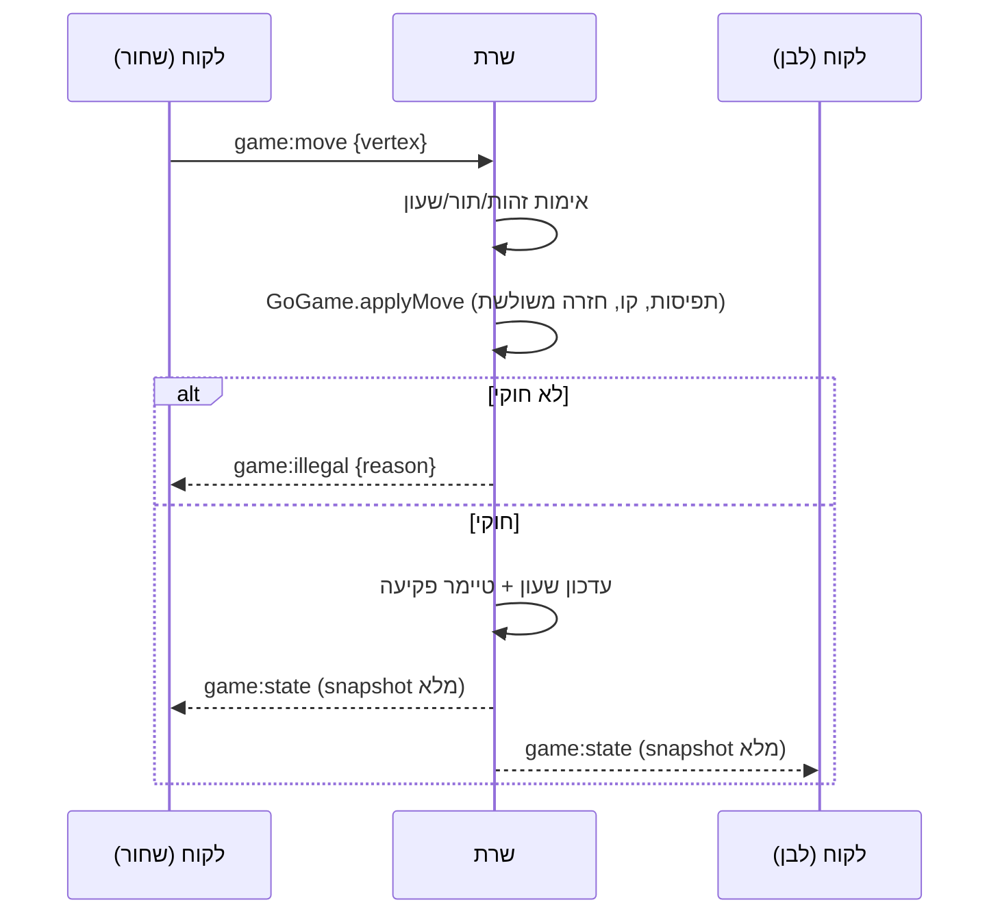

# 🦝 סלון הגו של טאנוקי (Tanuki Go Salon)

פלטפורמת **גו (Go/Baduk)** מרובת-משתתפים בזמן אמת, בהשראת סלוני הגו של *Hikaru no Go* —
בצבעי פסטל, עם שלוש דמויות חמודות: **עצלן 🦥, כריש 🦈 ומדוזה 🪼**.

## הרצה

```bash
npm install
npm run dev        # שרת על :3001 + לקוח (vite) על :5173
```

פותחים `http://localhost:5173` בשני חלונות דפדפן (או שני דפדפנים), נכנסים עם שם ודמות,
ולוחצים "מצא משחק" בשניהם.

```bash
npm test           # בדיקות המנוע (vitest) + בדיקת אינטגרציה של השרת
npm run build      # typecheck לכול + build של הלקוח; npm start מגיש הכול מ-:3001
```

## מה יש בפנים (v1)

- **לובי/סלון**: חדר 2D; הדמות שלך מסתובבת בו (קליק על הרצפה), עם השם מעל הראש —
  כפי שרואים אותך שאר המחוברים. שולחנות גו אמיתיים: כששניים משודכים, הדמויות
  "מתיישבות" סביב שולחן פנוי.
- **Matchmaking** פשוט: תור FIFO — כל שני ממתינים משודכים, צבעים מוגרלים.
- **לוח 9x9 אינטראקטיבי** בזמן אמת (קליק + אבן רפאים ב-hover), כל שחקן רואה את
  הלוח מהזווית שלו (ללבן הלוח מסובב 180°).
- **חוקי גו מלאים בצד השרת בלבד**: תפיסות, איסור התאבדות, קו (ko), **תיקו לפי
  חזרה משולשת** (triple-ko / superko), שני פסים → שלב ספירה עם סימון אבנים מתות
  בהסכמת שני הצדדים, ספירת **שטח (כללים סיניים)** עם קומי 7.5.
- **שעון Fischer** (5 דק' + 5 שנ' למהלך): הזמן יורד בתורך, increment נוסף אחרי כל
  מהלך, פקיעת זמן = הפסד. השרת לבדו קובע פקיעה.
- **דירוג**: Elo (K=32, התחלה 1500) ממופה לדרגות גו בסגנון EGF — כל 100 נקודות
  דרגה; 2100 = 1 דן (1500 ≈ 6 קיו).
- **צלילים מסונתזים** ב-Web Audio (בלי קבצי אודיו): "קלאק" הנחת אבן, רשרוש אבנים
  בתפיסה, טיק-טוק ב-10 השניות האחרונות.
- **אימון צומגו 🧩**: 12 בעיות חיים-ומוות קלאסיות (אטארי, סנאפ-בק, נקודות חיוניות,
  אטארי כפול…) ב-SGF עם עצי וריאציות; המחשב מגיב לפי העץ, פתרון מסומן `C[RIGHT]`.
  רץ כולו בלקוח מול אותו מנוע משותף.

## מבנה הריפו (npm workspaces)

```
packages/shared/   # @tanuki/shared — מנוע הגו (על @sabaki/go-board), ניקוד, שעון,
                   # דירוג, וטיפוסי הפרוטוקול. קוד טהור + בדיקות vitest.
apps/server/       # Node + TypeScript + Socket.io + express. מקור האמת היחיד.
apps/client/       # React + TypeScript + Vite. thin client: מצייר snapshots בלבד.
```

> הערה על הסטאק: הפרומפט המקורי הציע chess.js / react-chessboard — אלו ספריות
> **שחמט** ואינן ישימות לגו. ברוח אותו עיקרון ("לא לממש חוקים מאפס"), הוולידציה
> נבנתה על [`@sabaki/go-board`](https://github.com/SabakiHQ/go-board) (הספרייה של
> עורך הגו Sabaki): תפיסות, חירויות, התאבדות וקו. מעליה הוספנו (ב-`GoGame`) תורות,
> חזרה משולשת, שלב ניקוד וספירה. הלוח מצויר כ-SVG ייעודי ב-React.

## ארכיטקטורת הסנכרון

**מקור האמת הוא השרת בלבד.** הלקוח לא מריץ מנוע משחק במשחק מקוון — הוא משדר
כוונות ("רוצה לשחק בנקודה הזו") ומצייר את ה-snapshot שחוזר.

מה קורה כשלקוח שולח מהלך:

1. הלקוח פולט `game:move {gameId, vertex}` (קואורדינטות לוח קנוניות — הסיבוב
   ללבן הוא עניין תצוגתי בלבד בלקוח).
2. השרת מאמת: המשחק קיים, הסוקט שייך לאחד השחקנים, המשחק ב-`playing`, זה תורו.
3. השרת בודק את השעון: אם הזמן אזל — המהלך נדחה והמשחק מסתיים בפקיעה.
4. המנוע המשותף (`GoGame.applyMove`) מאמת את חוקי הגו: נקודה פנויה, לא התאבדות,
   לא קו, ומבצע תפיסות. כל פוזיציה (לוח + תור) נרשמת ב-hash; הופעה שלישית של
   אותה פוזיציה ⇒ תיקו.
5. מהלך לא חוקי ⇒ `game:illegal {reason}` לשולח בלבד, שום דבר לא משתנה.
6. מהלך חוקי ⇒ עדכון שעון Fischer (ירידה + increment), תזמון מחדש של טיימר
   הפקיעה, ושידור `game:state` **מלא** (snapshot, לא דלתא) לשני השחקנים בחדר.
7. הלקוח מצייר את ה-snapshot ומנגן צלילים לפי diff מה-snapshot הקודם
   (אבן חדשה ⇒ קלאק; אבנים שנעלמו ⇒ רשרוש תפיסה).



החלטות עיצוב:

- **snapshot מלא בכל עדכון** — אין ניהול דלתאות; התאוששות מניתוק היא טריוויאלית
  (מצטרפים לחדר ומקבלים snapshot).
- **בלי optimistic updates** — הלקוח מציג אבן-רפאים ב-hover ומחכה לאישור השרת.
  בלטנסי סביר זה בלתי מורגש, ונחסך כל צורך ב-rollback.
- **שעון**: השרת שולח `remainingMs + serverNow`; הלקוח מריץ אינטרפולציה מקומית
  לתצוגה חלקה בלבד. פקיעה נקבעת רק בשרת (טיימר שמאופס בכל מהלך ומאומת שוב מול
  השעון לפני שיפוט).
- **חיבור מחדש**: הלקוח שומר session token ב-localStorage; `lobby:join` עם token
  קיים מחזיר את המשתמש (כולל משחק פעיל). ניתוק באמצע משחק ⇒ חלון חסד של 60
  שניות ואז הפסד טכני.
- **אחסון**: in-memory מאחורי ממשק `Store` — נקודת החלפה עתידית ל-DB בלי לגעת
  בשאר הקוד.
